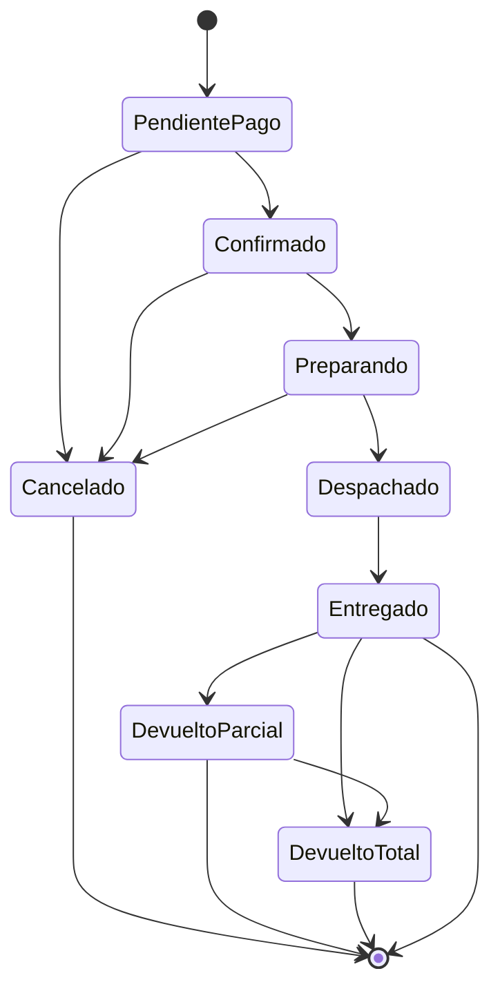
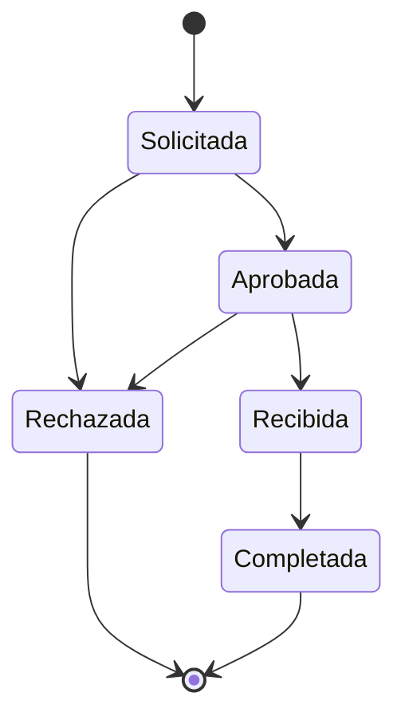

# ShopCart

## Arquitectura general

- Backend: Node.js + Express + TypeScript (`backend/`)
- Base de datos: SQL Server (`GDA26_OT_LuisReyes`)
- Autenticación: JWT + refresh token en cookie `refreshToken` (HttpOnly, Secure, SameSite)
- Inventario: fuente única en `Inventarios` (`existenciaFisica`, `cantidadReservada`).

## Módulos implementados

- Auth, Usuarios, Categorías, Productos/Variantes, Atributos/Valores, Géneros, Categorías-Atributos
- Proveedores, Compras + Anulación
- Cupones + validación por categoría
- Inventario (movimientos/kardex/disponibilidad)
- **Pedidos + Devoluciones**
- **Tienda pública (endpoints sin autenticación)**
- **Dashboard y reportes (admin/operador)**

## Ciclo de vida de pedidos



### Transiciones permitidas

| Desde | Hacia | Actor | Efectos |
|---|---|---|---|
| PendientePago (1) | Confirmado (2) | Cliente dueño / Invitado / Operador/Admin | Confirma uso de cupón (`CuponesUsos` pasa a `Confirmado`). El cliente dueño y el invitado solo pueden ejecutar esta transición |
| PendientePago/Confirmado/Preparando | Cancelado (6) | Cliente/Operador/Admin | Libera reservas, libera/cancela cupón (`Liberado`/`Expirado`), decrementa `totalUsos`, registra historial con motivo |
| Confirmado (2) | Preparando (3) | Operador/Admin | Sin cambio de stock/reservas |
| Preparando (3) | Despachado (4) | Operador/Admin | Valida reserva no vencida; baja `existenciaFisica` y `cantidadReservada` por variante; crea kardex `Salida por venta` (tipo 2); marca reservas `Confirmada`; asegura cupón `Confirmado` |
| Despachado (4) | Entregado (5) | Operador/Admin | Sin movimiento de inventario |
| Entregado (5) | DevueltoParcial (7)/DevueltoTotal (8) | Cliente/Operador/Admin | Vía solicitud/aprobación/recepción de devolución |

Estados 7/8 solo se actualizan mediante el flujo de devoluciones.

## Ciclo de vida de devoluciones



### Flujo de devolución

1. `POST /api/pedidos/:IDPedido/devoluciones` (Cliente dueño / Invitado / Operador/Admin): valida pedido en estado 5 o 7, agrega líneas (`IDPedidoDetalle`, `cantidad`), verifica que `cantidad + cantidadDevuelta + pendiente(Solicitada/Aprobada) <= cantidad vendida`, calcula reembolso por línea (`ROUND(totalLinea*cantidad/cantidadVendida,2)`) y clampa al remanente. Determina `Parcial`/`Total`. El invitado solo puede operar pedidos de su token.
2. `PATCH /api/devoluciones/:IDDevolucion/estado` (Operador/Admin): `Solicitada->Aprobada`, `Aprobada->Recibida` o `Rechazada`, `Recibida->Completada`.
3. Al pasar a `Recibida`: incrementa `PedidosDetalles.cantidadDevuelta`, fija `cantidadReintegrada=cantidad`, incrementa `Inventarios.existenciaFisica`, crea kardex `Devolución de cliente` (tipo 5), actualiza estado del pedido a `DevueltoTotal` (8) si todas las líneas quedan completamente devueltas, sino `DevueltoParcial` (7).

## Reservas, cupón y vencimiento

- Al crear pedido con stock suficiente se reserva `cantidadReservada` por variante (ordenado por `IDProductoVariante`). Se crean `InventariosReservas` (`Reservada`) con `fechaExpiracion = now + @MinutosExpiracion` (1-1440, default 15).
- Cupón: se bloquea con `UPDLOCK,HOLDLOCK`, se valida estado/fechas/límites/monto mínimo/categorías y usos por cliente. Si aplica, se descuenta por línea (redondeo) y se inserta `CuponesUsos` (`Reservado`), se incrementa `Cupones.totalUsos`. Al confirmar pedido pasa a `Confirmado`. Al cancelar/liberar/vencer pasa a `Liberado`/`Expirado` y se decrementa `totalUsos`.
- Vencimiento: `SP_Pedidos_LiberarReservasVencidas` libera reservas vencidas de pedidos en 1-2-3, marca `Expirada`/`Liberada`, expira cupón, cancela pedido a 6 con actor sistema y registra historial. Servicio `reservaExpiration.service.ts` ejecuta cada `RESERVAS_EXPIRACION_INTERVALO_MS` (default 60000) tras `server.listen()`.

## Endpoints

| Método | Ruta | Roles | Descripción |
|---|---|---|---|
| `POST` | `/api/clientes/token-invitado` | público | Generar token de invitado (43 chars, `[A-Za-z0-9_-]{16,64}`). No requiere auth ni persiste nada |
| `POST` | `/api/pedidos` | 1,3 / invitado | Crear pedido (cliente, admin o invitado). Requiere `productos[] {IDProductoVariante,cantidad}`, `direccionEntrega` y, para invitados, `nombre`, `apellido`, `correo` |
| `GET` | `/api/pedidos` | 1,2,3 / invitado | Listar pedidos. Cliente ve solo propios; invitado ve solo los de su token; filtros `IDCliente`, `IDEstadoPedido`, `buscar` |
| `GET` | `/api/pedidos/:IDPedido` | 1,2,3 / invitado | Obtener pedido (header/detalles/historial). Cliente solo propio; invitado solo con su token |
| `GET` | `/api/pedidos/:IDPedido/devoluciones` | 1,2,3 / invitado | Listar devoluciones de un pedido (detalle incluido). Invitado solo con su token |
| `PATCH` | `/api/pedidos/:IDPedido/estado` | 1,2,3 / invitado | Cambiar estado. Operador/Admin: 2/3/4/5. Cliente dueño e invitado: solo `1 -> 2` (confirmar pago) |
| `POST` | `/api/pedidos/:IDPedido/cancelar` | 1,2,3 / invitado | Cancelar pedido (requiere `motivo`, estados 1-2-3) |
| `POST` | `/api/pedidos/:IDPedido/devoluciones` | 1,2,3 / invitado | Solicitar devolución (invitado solo para pedidos de su token) |
| `GET` | `/api/devoluciones` | 1,2 | Listar todas las solicitudes de devolución (motivo incluido). Filtros `estado`, `buscar` |
| `PATCH` | `/api/devoluciones/:IDDevolucion/estado` | 1,2 | Cambiar estado de devolución |

### Dashboard y reportes (admin/operador)

Endpoints protegidos (`/api/dashboard`, roles 1 y 2), solo pedidos completados (estados 5/7/8), excluyendo cancelados y descontando devoluciones:

| Método | Ruta | Descripción |
|---|---|---|
| `GET` | `/api/dashboard/ventas?periodo=dia\|semana\|mes` | Ventas por período (`total` en quetzales y `numeroPedidos`). Filtros `fechaDesde`, `fechaHasta` |
| `GET` | `/api/dashboard/ventas-por-categoria` | Ventas por categoría (cantidad y monto neto) |
| `GET` | `/api/dashboard/top-productos?top=10` | Top productos más vendidos (cantidad y monto neto) |
| `GET` | `/api/dashboard/pedidos` | Listado de pedidos con filtros `estado`/`IDEstadoPedido`, `IDCliente`, `fechaDesde`, `fechaHasta`, `buscar`, paginación |

### Módulo público (tienda en línea, sin token)

Endpoints de solo lectura expuestos en `/api/public`, sin `Authorization`:

| Método | Ruta | Descripción |
|---|---|---|
| `GET` | `/api/public/productos/shop` | `SP_Producto_ConsultarProductoVariantesShop`: busca/filtra productos activos con variantes y atributos. Filtros `buscar`, `idGenero`, `idCategoria`, `atributos` (JSON) |
| `GET` | `/api/public/productos` | `SP_Producto_ListarProductos`: listado paginado de productos activos |
| `GET` | `/api/public/productos/:id` | `SP_Producto_ObtenerProductoPorID`: detalle de producto (solo activos) |
| `GET` | `/api/public/productos/:id/variantes` | `SP_Producto_ObtenerVariantes`: variantes de un producto (paginado) |
| `GET` | `/api/public/categorias` | `SP_Categorias_ListarCategoria` |
| `GET` | `/api/public/generos` | `SP_Producto_ObtenerGeneros` |
| `GET` | `/api/public/atributos` | `SP_Producto_ObtenerAtributos` |
| `GET` | `/api/public/valores-atributos` | `SP_Producto_ObtenerValoresAtributo` (filtro `IDAtributo`/`idAtributo`) |
| `GET` | `/api/public/config` | Configuración de tienda: moneda (GTQ) e IVA (`IVA_PORCENTAJE`, incluido en precios) |

Todos aceptan `pagina` y `registrosPorPagina` al estilo de `SP_Producto_ListarProductos` (juntos o ninguno).

Nota de negocio: los montos se manejan en quetzales (GTQ) y los precios publicados incluyen IVA del 12 %. La tasa se configura con la variable de entorno `IVA_PORCENTAJE` (default 12) y se expone en `GET /api/public/config` (`ivaPorcentaje`, `ivaIncluido: true`, `moneda: "GTQ"`). Al crear un pedido, el IVA se desglosa en `ivaPorcentaje` y `montoIva` sin alterar el `total`.

### Paginación

Todos los listados reciben `pagina` y `registrosPorPagina` al estilo de `SP_Producto_ListarProductos` (pueden enviarse **juntos o ninguno**):

- Sin ninguno: devuelve **todos** los registros (`data` completo, `paginacion.totalPaginas = null`).
- Con uno solo: responde **400** "Debe enviar ambos parametros de paginacion." (`registrosPorPagina` ≤ 100 en pedidos; en ambos casos `pagina` ≥ 1 y `registrosPorPagina` ≥ 1).
- La respuesta incluye `paginacion: { pagina, registrosPorPagina, totalRegistros, totalPaginas }`.

| Listado | Endpoint | Filtros |
|---|---|---|
| Pedidos | `GET /api/pedidos` | `IDCliente`, `IDEstadoPedido`, `buscar` |
| Devoluciones de un pedido | `GET /api/pedidos/:IDPedido/devoluciones` | — (el detalle de líneas no se pagina) |
| Devoluciones global | `GET /api/devoluciones` | `estado` (`Solicitada`, `Aprobada`, `Rechazada`, `Recibida`, `Completada`), `buscar` (`numeroPedido`, `motivo`, contacto o correo del cliente) |

Módulos con paginación al mismo patrón: categorías, usuarios, atributos, valores de atributo, categorías-atributos, cupones, proveedores, compras, inventario (kardex), variantes por producto, atributos por categoría, productos, géneros, pedidos y devoluciones.

**Cambio de contrato**: `GET /api/pedidos` y `GET /api/pedidos/:IDPedido/devoluciones` ya no aceptan `tamanoPagina` (se acepta ignorar / pasar al SP da 400). Usar `registrosPorPagina`.


### Modo invitado (carrito stateless)

El invitado no tiene sesión: el front guarda las líneas del carrito y un token propio. El backend solo persiste el token en el pedido.

- **Generar el token**: `POST /api/clientes/token-invitado` (público, sin body) responde `201` con `{ data: { token } }`. El token es un secreto de 43 caracteres (`[A-Za-z0-9_-]{16,64}`) opaco y no se persiste: el invitado lo guarda y lo usa para crear/consultar/confirmar sus pedidos.
- Token: header `X-Invitado-Token` (también aceptado como `tokenInvitado` en body o query).
- El invitado **no tiene identidad conocida, por eso el contacto es obligatorio**: al crear pedido debe enviar `nombre`, `apellido` y `correo` (máx 100/100/150 caracteres, correo con `@` y dominio). Sin ellos el pedido se rechaza (`50804`, HTTP 400).
- El cliente puede sobreescribir el contacto con los mismos campos (override). Si no los envía, se usan `nombre`, `apellido` y `correo` de su perfil (`Clientes` → `Usuarios`).
- Crear pedido: `POST /api/pedidos` sin `Authorization` y con el header del token. El token se guarda en `Pedidos.tokenInvitado`.
- Las respuestas de listar/obtener pedido devuelven `nombre`, `apellido` y `correo` (los del perfil del cliente si no se sobreescribieron; los enviados por el invitado).
- Consultar/listar/cancelar/confirmar pago: mismas rutas sin `Authorization`, con el token. Sin token o con token ajeno responde `401`/`404`.
- El invitado solo puede mover su pedido de `PendientePago (1)` a `Confirmado (2)`, igual que el cliente dueño.
- Cupones: disponibles también para invitados (`POST /api/cupones/validar` acepta el token). El límite `limiteUsosCliente` se controla por `IDUsuario` o, para invitados, por `tokenInvitado` (`CuponesUsos.tokenInvitado`).
- Devoluciones: disponibles para invitados sobre pedidos de su token (`PedidosDevoluciones.tokenInvitado`). El cambio de estado de la devolución sigue siendo exclusivo de operador/admin.
- Un mismo token puede tener varios pedidos.
- `GET /api/devoluciones` (listado global) está restringido a operador/admin; el invitado solo ve las devoluciones de sus pedidos, y la respuesta ya no expone `tokenInvitado`.

## Códigos de error relevantes

| Código | Significado |
|---|---|
| 50300 | Cupón no existe |
| 50331 | Cupón inactivo |
| 50332 | Cupón no vigente |
| 50333 | Cupón vencido |
| 50334 | Cupón agotado (límite total) |
| 50335 | Cupón no aplica a productos del pedido |
| 50336 | No alcanza monto mínimo |
| 50337 | Límite por cliente alcanzado |
| 50801 | Transición de estado de pedido no permitida / duplicado |
| 50802 | Falta usuario que ejecuta el cambio (trigger) |
| 50803 | Usuario sin perfil de cliente / inactivo |
| 50804 | Validación de pedido (dirección/líneas/json/expiración/contacto invitado: nombre, apellido y correo con los límites 100/100/150) |
| 50807 | Reserva expirada, no se puede despachar |
| 50808 | Stock insuficiente al reservar |
| 50809 | Pedido no existe |
| 50810 | Líneas de devolución inválidas |
| 50811 | Cantidad a devolver supera lo vendido / pendiente |
| 50812 | Transición de devolución no permitida |
| 50816 | Pedido no permite devoluciones |
| 50817 | Motivo/restricciones de devolución |
| 50820/50821 | Validación de transición/historial de devolución |
| 50822 | Debe enviar ambos parametros de paginacion (`pagina` y `registrosPorPagina` juntos o ninguno) |
| 50823 | La pagina y los registros por pagina deben ser mayores a cero |
| 50824 | El estado de devolucion no es valido |

## Desarrollo

```bash
cd backend
npm run dev  # tsx watch app.ts
npx tsc --noEmit
```

Variables: ver `backend/.env` (`SQL_HOST`, `SQL_USER`, `SQL_PASSWORD`, `SQL_DATABASE`, `PORT`, `FRONTEND_URL`, `RESERVAS_EXPIRACION_INTERVALO_MS`).

